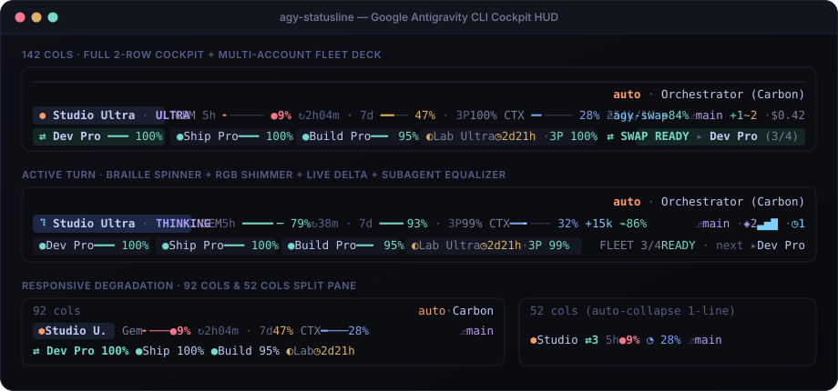

<div align="center">

# agy-statusline

**Adaptive 2-row cockpit statusline HUD for Google Antigravity CLI (`agy`)**

[](https://github.com/aklkbqx/agy-statusline/releases)
[](LICENSE)
[-bb9af7?style=flat-square)](go.mod)
[](https://github.com/aklkbqx/agy-statusline/releases)

<br/>



<p>
  <a href="#why-agy-statusline">Why</a> ·
  <a href="#install">Install</a> ·
  <a href="#glyph-reference">Glyphs</a> ·
  <a href="#multi-account-fleet-deck">Fleet Deck</a> ·
  <a href="#themes">Themes</a> ·
  <a href="#commands">Commands</a> ·
  <a href="#security-and-privacy">Security</a>
</p>

</div>

`agy-statusline` replaces shell/jq scripts with a single zero-dependency Go binary (`~3ms` cached execution) tailored for `agy`. It aligns flush across your full terminal width, matches `agy`'s color scheme automatically, tracks live Gemini & Claude/GPT quota burn rates, and turns [`agy-swap`](https://github.com/aklkbqx/agy-swap) into a live multi-account Fleet Deck underneath your prompt.

## Why agy-statusline

- **Full-width Left ↔ Right layout**: Snaps flush to your exact `terminal_width` right below `agy`'s native mode/model line across 7 responsive breakpoints — collapsing cleanly down to 28-column split panes without wrapping.
- **Seamless half-step laser gauges**: Uses crisp 1-cell Box-Drawing glyphs (`━╸─`) instead of gapped blocks or wide emojis, with zero-width Thai/Unicode combining-mark width math (`DisplayWidth`) so alignment stays exact on every font.
- **Multi-account `agy-swap` Fleet Deck (Row 2)**: Shows all reserve accounts sorted by readiness (`ready` → `partial` → `cooldown` → `unavailable`), detects pool-specific availability (e.g. `Gemini` in cooldown while `3P` is `100%` ready), and maintains live cross-account quota memory when you switch sessions.
- **Zero-CPU hardware-pulsed indicators**:
  1. **Active turn beacon**: Hardware SGR `5` pulsing cyan beacon (`◆`), crisp active status pill (`THINKING`, `TOOL`, `STREAM`), illuminated laser gauge tip, and pulsing subagent badge (`◈2`) — stays smooth even between event-driven `agy` refreshes (`AGY_STATUSLINE_NO_BLINK=1` turns blink off).
  2. **Critical & swap alerts**: Terminal hardware SGR `5` pulse on critical `<= 15%` quota, `CONFIRM` prompts (`◉`), and the `#1` ready swap account (`⇄`).
  3. **Live session delta**: Tracks `+Nk` token jumps for 8 seconds and elapsed conversation time (`◴14m`).
- **Non-blocking SWR Git porcelain**: Stat-invalidates immediately on `.git/HEAD`, `.git/index`, and ref mutations (instant branch updates on frame 0), refreshes `git status --porcelain=v2 --branch` with `GIT_OPTIONAL_LOCKS=0` asynchronously via stale-while-revalidate (2s TTL), and shows linked worktree (`⧉`), staged/modified/untracked/conflict counts, and ahead/behind arrows.

## Install

Pre-built binaries for `darwin/arm64`, `darwin/amd64`, `linux/arm64`, `linux/amd64`, `windows/arm64`, and `windows/amd64` are published on [GitHub Releases](https://github.com/aklkbqx/agy-statusline/releases).

### macOS and Linux

```sh
curl -fsSL https://raw.githubusercontent.com/aklkbqx/agy-statusline/main/install.sh | sh
agy-statusline install
```

### Windows (PowerShell)

```powershell
irm https://raw.githubusercontent.com/aklkbqx/agy-statusline/main/install.ps1 | iex
agy-statusline install
```

### Go install or build from source

Requires Go 1.27 or newer:

```sh
go install github.com/aklkbqx/agy-statusline/cmd/agy-statusline@latest
agy-statusline install
```

Or build locally:

```sh
git clone https://github.com/aklkbqx/agy-statusline.git
cd agy-statusline
make enable
```

To replace `agy`'s built-in status row instead of stacking underneath it:

```sh
agy-statusline install --replace
```

To revert at any time:

```sh
agy-statusline uninstall
```

## Glyph reference

| Glyph | Meaning | Notes |
| :--- | :--- | :--- |
| `⬢` / `◆` / `◉` | Account / Active beacon / Confirmation required | Surface pill changes tint by state (`idle` / `working` / `confirm`); `◆` and `◉` use SGR `5` pulse |
| `━╸─` | Half-step quota & context gauge | Even `1%–9%` keeps a lit `╸` tip so low pools never look `0%` |
| `▲` | Burn-rate pace warning | Shown when quota consumption is `>= 15%` ahead of elapsed window time |
| `↻2h04m` | Time until bucket resets | Shown when `5h < 100%` or `7d <= 30%` |
| `⌁84%` | Prompt cache hit ratio | Shown when cached read tokens make up `>= 10%` of prompt tokens |
| `+15k` | Recent context token jump | Displayed for 8 seconds after a turn adds `>= 500` tokens |
| `⇄` | Best ready swap account | Highlighted when active pool drops below `25%` |
| `●` / `◐` / `◌` | Fleet account state | Ready / Partial (other model pool usable) / Cooldown or unavailable |
| `⌂` / `⧉` / `⎇` | Workspace / Linked Git worktree / Branch | Includes `+staged ~modified ?untracked ✖conflicts ↑ahead ↓behind` |
| `◈2` / `◷1` / `✦2` | Active subagents / Background tasks / Artifacts | Hidden automatically when count is zero (`◈` pulses via SGR `5` while active) |

## Multi-account Fleet Deck

When `~/.gemini/agy-swap/accounts.json` is present, Row 2 displays your non-active accounts on terminals `>= 58` columns wide:

- Switching `agy` to a Claude or GPT model automatically foregrounds the `3P` pool on Row 1 and re-evaluates Row 2 against `3P` cooldowns and quotas.
- Set `AGY_STATUSLINE_SINGLE_LINE=1` to keep everything on 1 line at all terminal widths, or `AGY_CLI_HIDE_ACCOUNT_INFO=1` to hide all account names and fleet rows.

## Themes

`agy-statusline` auto-matches `~/.gemini/antigravity-cli/settings.json` `"colorScheme"` or accepts `AGY_STATUSLINE_THEME`:

- `tokyo-night` *(default)*
- `catppuccin`
- `gruvbox`
- `nord`
- `dracula`
- `mono`

Preview every palette in your terminal:

```sh
agy-statusline themes
```

See [docs/configuration.md](docs/configuration.md) for all environment variables and `settings.json` options.

## Commands

```sh
agy-statusline install      # Configure ~/.gemini/antigravity-cli/settings.json safely
agy-statusline uninstall    # Revert statusLine to default empty config
agy-statusline doctor       # Inspect binary, settings.json, git, and agy-swap (counts only)
agy-statusline demo --all   # Preview 142 / 96 / 52-column layouts with synthetic data
agy-statusline themes       # Preview all built-in palettes
agy-statusline version      # Print version and build metadata
```

## Troubleshooting

- **Older open `agy` panes still show `exit status 127` / auto-disabled**: Long-lived `agy` sessions cache `settings.json`'s `statusLine.command` in memory at startup. Run `agy-statusline install` (which creates the fail-open command guard and a compatibility symlink at `~/.gemini/antigravity-cli/bin/agy-statusline` without touching `agentapi`), then type `/statusline on` once in any pane that had already auto-disabled after 30 failures.
- **Re-installing while `agy` is open**: `make install` and `install.sh` replace binaries atomically (`mv -f`), avoiding transient `ENOENT` or macOS code-signature races during 300ms statusline polls.

## Security and privacy

- **Zero network calls & zero telemetry**: Never opens sockets or sends analytics.
- **No secret reads**: Reads only non-secret metadata in `~/.gemini/agy-swap/{config.json,accounts.json}`. Never touches `vault.json`, `oauth_creds.json`, or the OS Keychain.
- **Safe config writes**: `install` and `uninstall` parse existing `settings.json` first, refuse to overwrite malformed JSON, preserve all unrelated keys, and write atomically (`0600`).
- **Private local cache**: Ephemeral fleet quota memory, session deltas, and Git porcelain caches live under your user cache directory (`0700` directory, `0600` files).
